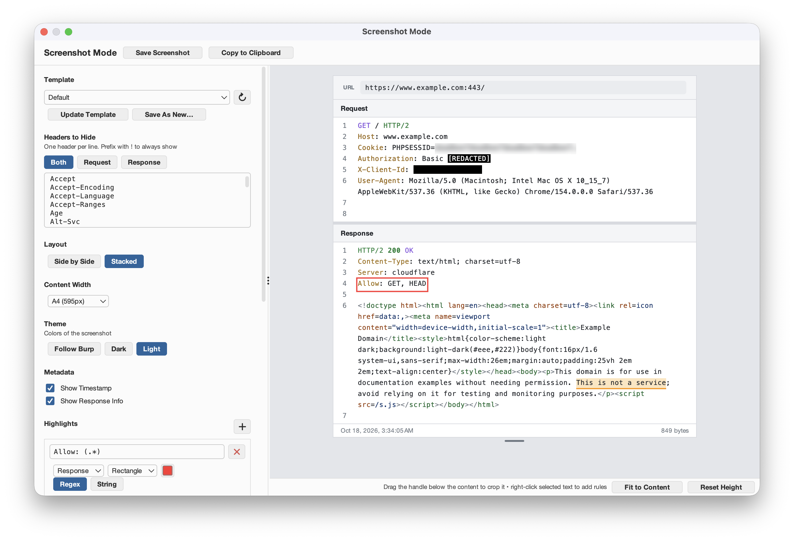

# Screenshot Mode for Burp Suite

<p>
  <a href="https://github.com/unlock-security/burp-screenshot-mode/actions/workflows/release.yml"></a>
  <a href="https://github.com/unlock-security/burp-screenshot-mode/releases/latest"></a>
  <a href="https://openjdk.org/projects/jdk/21/"></a>
  <a href="https://central.sonatype.com/artifact/net.portswigger.burp.extensions/montoya-api/2026.7"></a>
  <a href="https://portswigger.net/burp"></a>
  <a href="LICENSE"></a>
  <a href="https://www.unlock-security.it/?utm_source=github&utm_medium=repo&utm_campaign=screenshot-mode"></a>
</p>

Take pretty screenshots of requests and responses directly inside Burp Suite, ready to drop into a report.
No external tools, no manual cropping and blurring.

> This is a Burp Suite (Montoya API) port of Caido's [Screenshot Mode](https://github.com/caido-community/screenshot-mode) plugin.



## Features

- **Live preview** of the request and response in a dedicated window, laid out side by side or stacked, with line
  numbers, wrapping and HTTP/JSON/XML/HTML syntax colors.
- **Hide noisy headers** (`Accept-*`, `Sec-*`, CDN headers, …) for both messages or only the request/response.
  Prefix a header with `!` to always show it.
- **Highlights**: regex or literal patterns, painted as a translucent marker or as a rectangle, in any color.
- **Redactions**: blur, opaque box or replacement text (`[REDACTED]`), optionally limited to selected capture
  groups (e.g. `session=([0-9a-f]+)` redacts only the value).
- **Right-click selected text** in the preview to highlight it, redact it or hide its header in one click.
- **Content width** presets for reports: full width, custom pixels, A4 (595px) or Letter (612px).
- **Crop** the captured height with the drag handle, or **Fit to Content** to show the whole messages.
- **Metadata footer**: request timestamp and response size/round-trip time.
- **Templates**: save settings as named templates, pick a default, edit or duplicate them from the *Screenshot Mode*
  suite tab, and import/export them as JSON.
- **Export** as a 2× PNG file or straight to the clipboard.

## Usage

1. Right-click a request anywhere in Burp (Repeater, Proxy, HTTP history, Target site map, Logger, …) and choose
   **Extensions › Screenshot Mode › Screenshot**, or press **Ctrl+Shift+S**.
2. Pick a template and tweak headers, layout, width, highlights and redactions. The preview updates as you type.
3. Click **Copy to clipboard** (**⌘C** / **Ctrl+C**) or **Save PNG…** (**⌘S** / **Ctrl+S**). Copy only copies the
   screenshot when no text is selected; with a selection it copies the text as usual.

From a message editor, the screenshot shows what the editor currently holds, including unsent edits in Repeater.\
When several rows are selected in a table, the first one is used.

Settings changed in the screenshot window apply to that message only, and are remembered if you screenshot the
same message again; a **Modified** label shows when they differ from the template. Use **Update template** or
**Save as new…** to keep them, or **Revert** to go back to the template. The **Screenshot Mode** suite tab
manages the templates.

## Installation

Requires Burp Suite Professional or Community 2025.x or newer (Java 21).

1. Build the jar (see below), or grab it from the [releases](https://github.com/unlock-security/burp-screenshot-mode/releases).
2. In Burp, go to **Extensions › Installed › Add**, choose **Java** as the extension type and select
   `build/libs/screenshot-mode-<version>.jar`.

## Building

```bash
./gradlew build
```

This compiles against the Montoya API, runs the tests and produces a self-contained jar in `build/libs/`.
Local builds are versioned `0.0.0-SNAPSHOT`; release builds get their version from the release tag
(`./gradlew build -PreleaseVersion=1.2.3`).

The tests also render sample screenshots without Burp into `build/preview/`. On a desktop session,
`./gradlew test -PpreviewUi` additionally renders the screenshot window and the suite tab.

## Code formatting

Java sources are formatted with [Prettier](https://prettier.io) and
[prettier-plugin-java](https://github.com/jhipster/prettier-java) (configuration in `.prettierrc.json`).
Run `npm install` once after cloning: it installs Prettier and enables a git pre-commit hook (husky + lint-staged)
that formats the staged Java files on every commit.

- **VS Code** formats Java files on save with the recommended Prettier extension (`esbenp.prettier-vscode`), as
  configured in `.vscode/settings.json`.
- `npm run format` formats the whole codebase, `npm run format:check` verifies it (e.g. in CI).

## Contributing and releases

Work happens on `dev`; `main` only receives pull requests from `dev`, merged with a **merge commit** (not squash, so
`dev` and `main` don't diverge). Every push to `main` runs the tests and, when warranted, publishes a release: no
version number is ever edited by hand.

Commit messages follow [Conventional Commits](https://www.conventionalcommits.org), which decide the next version:

| Commit | Example | Release |
|--------|---------|---------|
| `fix:` | `fix(ui): keep the crop height when switching template` | patch (`1.4.2` → `1.4.3`) |
| `feat:` | `feat: export screenshots as PDF` | minor (`1.4.2` → `1.5.0`) |
| `!` after the type, or a `BREAKING CHANGE:` footer | `feat!: new template format` | major (`1.4.2` → `2.0.0`) |
| `docs:`, `chore:`, `test:`, `refactor:`, `ci:`, … | `docs: explain capture groups` | none |

`npm install` also adds a `commit-msg` hook that rejects non-conforming messages, and CI checks the commits of every
pull request.

On each push to `main`, [`.github/workflows/release.yml`](.github/workflows/release.yml) runs the CI checks, then
[semantic-release](https://semantic-release.gitbook.io) computes the version from the commits since the last tag,
builds the jar with that version, tags the commit `vX.Y.Z` and publishes a GitHub release with generated notes and
the jar attached. Pull requests and pushes to `dev` run [`.github/workflows/ci.yml`](.github/workflows/ci.yml)
(build and tests, formatting, commit messages, and for pull requests into `main`, that they come from `dev`).
The first release is `v1.0.0`, provided the commits on `main` include at least one `feat:` or `fix:`.

After every push to `main`, the release workflow also brings `dev` up to date with it, without rewriting history:
`dev` is fast-forwarded to `main` (so both point to the same commit, release tags included), or, if new commits
landed on `dev` in the meantime, `main` is merged into it with a `chore: merge main into dev` commit. Pull `dev`
after a release to get it locally. This needs `dev` to accept pushes from GitHub Actions, so don't put a
pull-request ruleset on it.

## Project layout

```
src/main/java/it/unlocksecurity/burp/screenshotmode/
├── ScreenshotModeExtension.java   Montoya entry point: suite tab, context menu, hotkey
├── BurpMessages.java              HttpRequestResponse → MessageData adapter
├── ScreenshotContextMenu.java
├── model/                         Settings, templates and rules (port of types.ts / schemas)
├── storage/                       JSON codec with migrations, template store on Burp preferences
├── render/                        Header filter, rule engine, syntax tokenizer, palettes
└── ui/                            Screenshot window, preview/capture, settings form, templates tab
```

## License

MIT, see [LICENSE](LICENSE). Based on the Caido plugin by Caido Labs Inc.
