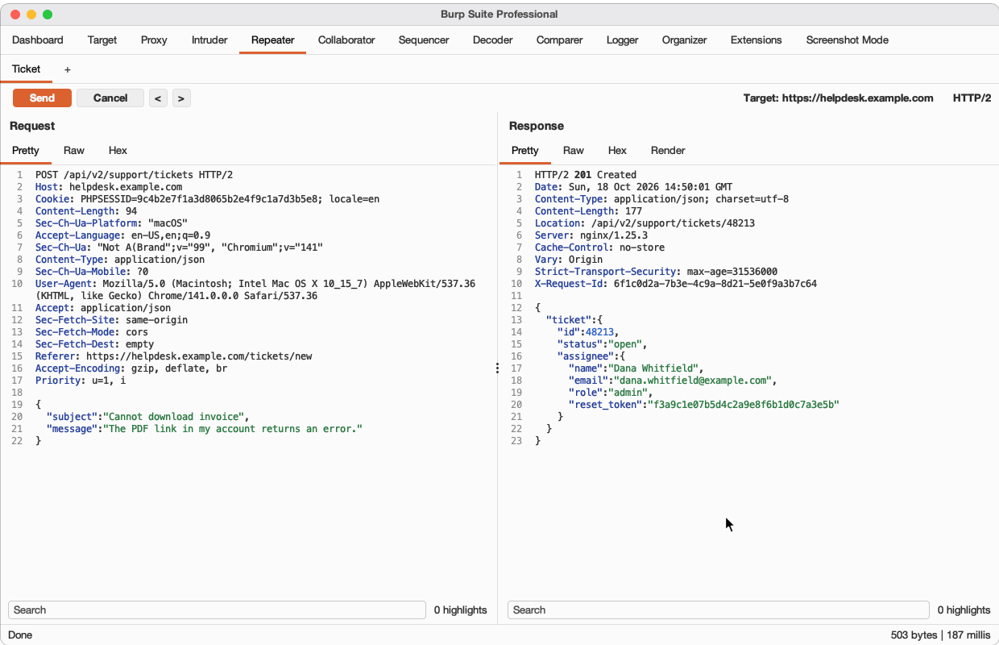
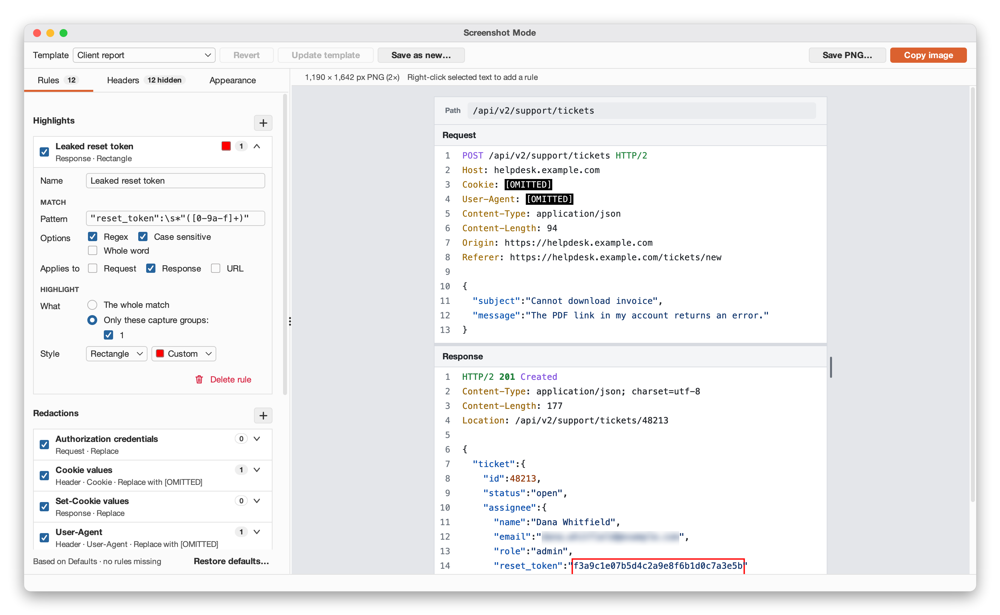
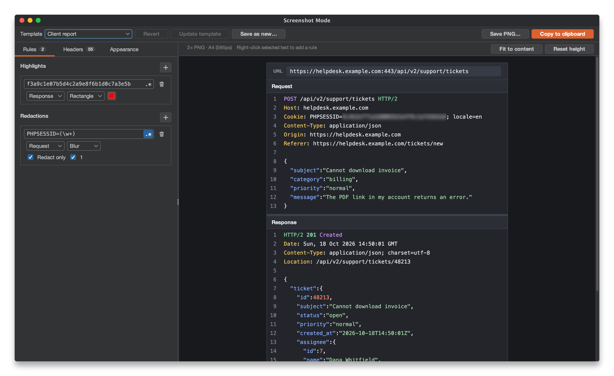
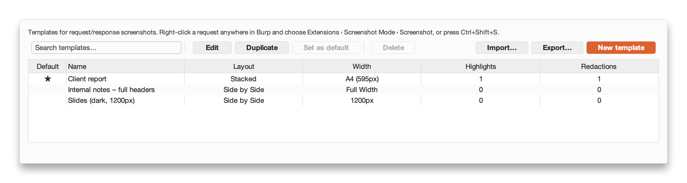
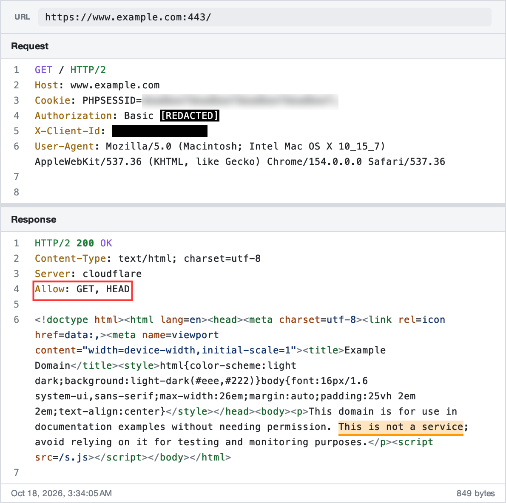
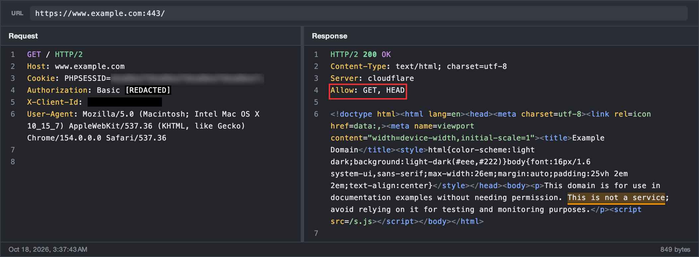

# Screenshot Mode for Burp Suite

<p>
  <a href="https://github.com/unlock-security/burp-screenshot-mode/actions/workflows/release.yml"></a>
  <a href="https://github.com/unlock-security/burp-screenshot-mode/releases/latest"></a>
  <a href="https://openjdk.org/projects/jdk/21/"></a>
  <a href="https://central.sonatype.com/artifact/net.portswigger.burp.extensions/montoya-api/2026.7"></a>
  <a href="https://portswigger.net/burp"></a>
  <a href="LICENSE"></a>
  <a href="https://www.unlock-security.it/?utm_source=github&utm_medium=repo&utm_campaign=screenshot-mode"></a>
</p>

Take pretty screenshots of requests and responses directly inside Burp Suite, ready to drop into a report.
No external tools, no manual cropping and blurring.

> Started as a port of Caido's [Screenshot Mode](https://github.com/caido-community/screenshot-mode) plugin, it has
> since grown into an independent project, with its own features and a UI designed for Burp.



## Features

- **Live preview** of the request and response in a dedicated window, laid out side by side or stacked, with line
  numbers, wrapping and HTTP/JSON/XML/HTML syntax colors.
- **Hide noisy headers** from a catalog of about 150 common headers in groups (content negotiation, caching, client
  hints, fetch metadata, CDNs, …): uncheck a header, or a whole group, to hide it. The screenshot window lists the
  headers of the message on screen, and the tab title counts how many it hides. Headers that aren't in the catalog are
  listed first, as custom headers; one used in both messages can be hidden in only one of them. By default, security
  headers and anything that can take part in request smuggling stay visible, as they can be the finding. Each header
  also says in words whether a rule redacts or highlights it, and links to that rule, or adds one with **Redact
  value…** or **Highlight…**.
- **Highlights**: painted as a translucent marker or as a rectangle, in any color.
- **Redactions**: replacement text (`[REDACTED]`), a black box or blur.
- **Two kinds of rules**, chosen when you add one with **+**: a **header** rule names one or more headers and
  redacts their whole value (a highlight marks the whole line), in requests and responses; a **text pattern** rule
  matches a regex or literal text in the request, the response, the URL or any of them, and a redaction can be
  limited to selected capture groups (e.g. `session=([0-9a-f]+)` redacts only the value).
- **One list of rules**: each rule has an optional name, an on/off checkbox and a one-line summary, and opens into
  its editor when clicked: what it matches (pattern, options, where it applies), then what it does with a match.
  Long patterns and header lists wrap in their field, so they are always shown whole. The built-in *Defaults* template comes with named redactions for credentials, cookies, API keys,
  passwords, tokens and JWTs, including in the URL, so a secret in the request line doesn't show up above it.
- **Rule checks**: in the screenshot window, each rule shows how many times it matched. A redaction with an invalid
  or too slow pattern, or set to redact only some capture groups with none chosen, is flagged on the *Rules* tab and
  above the preview, and **Copy** and **Save** ask before exporting a screenshot it may not fully cover.
- **Pretty view** for JSON, HTML, XML (SVG, RSS, SOAP, …), CSS and JavaScript bodies, like Burp's Pretty tab.
  Only line breaks and indentation change, so broken or malicious markup shows exactly as sent. Rules run on the pretty
  text: a pattern that relies on the original line breaks or spacing may match differently.
- **Right-click** in the preview to highlight or redact the selected text, or to hide, redact or highlight the header
  under the pointer, in one click.
- **Width**: as wide as the preview (*Full Width*), **Fit to content** so no line wraps (up to 2,000 px), A4 (595px),
  Letter (612px), or a custom width you type or set by dragging the handle on the right of the screenshot. A fixed width
  is exact whatever the window size (the preview scrolls sideways when it doesn't fit), and the toolbar shows the size
  of the PNG that Copy and Save produce.
- **Height**: as tall as the preview (*Full Height*), **Fit to content** to show every line of the request and
  response, which keeps fitting as you change the settings, or a custom height you set by dragging the handle below
  the screenshot. Saved in templates like the width. With A4 or Letter, the preview warns when the screenshot is taller
  than one page, and an image over 50 megapixels (about 2,400 × 21,000 px) can't be exported, as building it could run
  Burp out of memory.
- **Metadata footer**: request timestamp and response size/round-trip time. The timestamp shows only when Burp knows
  when the request was sent (not for an unsent Repeater edit), and a message with no response says so.
- **URL bar**: the full URL, only the path and query (the label reads *Path*), or no URL bar at all. Path only leaves
  out the scheme, host and port; the host can still appear in headers such as `Host`, `Origin` and `Referer`, so hide or
  redact those too if it must not show.
- **Templates**: save settings as named templates, pick a default, edit or duplicate them from the *Screenshot Mode*
  suite tab, and import/export them as JSON. Two built-in templates ship with the extension and are updated with it:
  *Defaults* (noisy headers hidden, secrets redacted) and *Empty* (messages as they are). They can't be edited or
  deleted: start a new template from one of them, or duplicate it. Your template keeps following its built-in
  template's hidden headers, except the ones you changed, so new releases can hide more noise for you; its rules and
  appearance are yours and never change by themselves. Template names are unique, ignoring case: an imported template
  whose name is taken is added as "name (imported)", so nothing is overwritten.
- **Template editor preview** on a made-up sample message, laid out like the screenshot window. With the *Rules* and
  *Headers* tabs, pick the URL, the request or the response: it is shown as written, and editable, beside how the
  screenshot shows it, so you can change a rule and the text it must match side by side. Each rule shows its matches
  in the sample. With the *Appearance* tab, the preview is the whole screenshot. Your edits to the sample last until
  Burp closes and are never saved in templates; **Restore sample** brings the original back.
- **Restore defaults** in each tab, from the built-in template yours is based on, after asking: the *Rules* tab adds
  back the rules you deleted (or replaces all your rules), the *Headers* tab drops your header changes, and the
  *Appearance* tab resets width, height, layout, theme, URL bar, body and footer. Each tab says what it would change.
- **Undo and redo** every change to the settings with **⌘Z** / **⇧⌘Z** (**Ctrl+Z** / **Ctrl+Shift+Z** or **Ctrl+Y**),
  in the screenshot window and in the template editor: deleted rules, restored defaults, rules added from the preview
  or the *Headers* tab, and **Revert** too. Typing counts as one step. Undo shows what it changed: it opens the tab
  and the rule it brought back. Deleting a rule also offers **Undo** right above the rules.
- **Export** as a 2× PNG file or straight to the clipboard.

## Screenshots

The screenshot window, in Burp's light and dark themes:




Templates are managed in the *Screenshot Mode* suite tab:



What ends up in your report:

<p>
  
  
</p>

## Usage

1. Right-click a request anywhere in Burp (Repeater, Proxy, HTTP history, Target site map, Logger, …) and choose
   **Extensions › Screenshot Mode › Screenshot**, or press **Ctrl+Shift+S**.
2. Pick a template and tweak the rules (highlights and redactions), the hidden headers and the appearance, each in
   its own tab. The preview updates as you type.
3. Click **Copy image** (**⌘C** / **Ctrl+C**) or **Save PNG…** (**⌘S** / **Ctrl+S**). Copy only copies the
   screenshot when no text is selected; with a selection it copies the text, with blurred and covered values replaced
   by `[REDACTED]`.

From a message editor, the screenshot shows what the editor currently holds, including unsent edits in Repeater.\
In a table, select one row: with several selected, **Screenshot** isn't offered and the shortcut does nothing.

Settings changed in the screenshot window apply to that message only, and are remembered if you screenshot the
same message again; a **Modified** label shows when they differ from the template. Use **Update template** or
**Save as new…** to keep them, or **Revert** to go back to the template. Switching template while they differ asks
first, so they aren't lost by accident. The **Screenshot Mode** suite tab manages the templates.

## Installation

Requires Burp Suite Professional or Community 2025.x or newer (Java 21).

1. Build the jar (see below), or grab it from the [releases](https://github.com/unlock-security/burp-screenshot-mode/releases).
2. In Burp, go to **Extensions › Installed › Add**, choose **Java** as the extension type and select
   `build/libs/screenshot-mode-<version>.jar`.

## Building

```bash
./gradlew build
```

This compiles against the Montoya API, runs the tests and produces a self-contained jar in `build/libs/`.

## Contributing

Bug reports, feature requests and pull requests are welcome. See [CONTRIBUTING.md](CONTRIBUTING.md) for the
development setup, code formatting, commit conventions and how releases work.

## License

MIT, see [LICENSE](LICENSE). Originally based on the Caido plugin by Caido Labs Inc.
